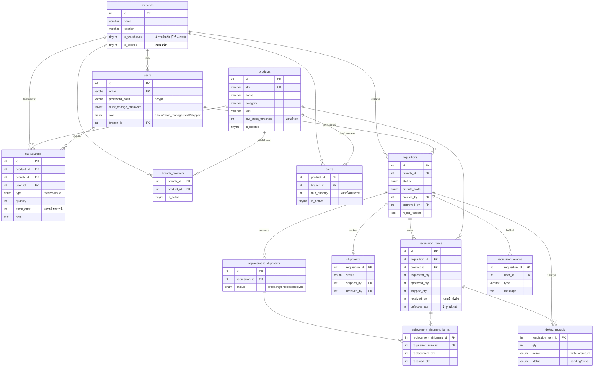

# การออกแบบฐานข้อมูล

ฐานข้อมูล: MariaDB 10.4 / MySQL (`inventory_db`, utf8mb4) — โครงสร้างเต็มอยู่ใน [`inventory-system/backend/schema.sql`](../inventory-system/backend/schema.sql)

## ER Diagram

## ตาราง

| ตาราง | หน้าที่ |
|---|---|
| `branches` | สาขา — `is_warehouse = 1` คือคลังหลัก (มีได้สาขาเดียว, ระบบบังคับตอนแก้ไข) · `is_deleted` ลบแบบซ่อน ประวัติไม่หาย |
| `users` | ผู้ใช้ + บทบาท + สาขา · `must_change_password` บังคับเปลี่ยนรหัสที่ admin ตั้งให้ |
| `products` | สินค้า/SKU · `low_stock_threshold` เกณฑ์แจ้งเตือนกลาง |
| `transactions` | **ทุกการเคลื่อนไหวของสต๊อก** (รับเข้า/ออก) — แหล่งความจริงเดียวของยอดคงเหลือ |
| `current_stock` (VIEW) | ยอดคงเหลือ = SUM(รับเข้า) − SUM(ออก) ต่อ สินค้า × สาขา |
| `branch_products` | สินค้าที่เปิดให้สาขาเห็น/ขอเบิก |
| `alerts` | เกณฑ์แจ้งเตือน**เฉพาะสาขา** (unique ต่อ สินค้า×สาขา) — ถ้ามีจะใช้แทนค่ากลาง |
| `requisitions` | ใบขอเบิก + สถานะ + สถานะย่อยของเคสที่มีปัญหา |
| `requisition_items` | รายการในใบ: ขอ → อนุมัติ → ส่ง → ได้รับดี / ชำรุด |
| `shipments` | การจัดส่งรอบแรก (1 ใบ : 1 รอบ) |
| `replacement_shipments` / `_items` | การส่งของชดเชย (มีได้หลายรอบ) |
| `requisition_events` | ไทม์ไลน์ + ข้อความโต้ตอบของแต่ละใบ |
| `defect_records` | ของชำรุดถูกตัดทิ้งที่สาขา หรือส่งคืนคลังหลัก |

## หลักการสำคัญ

**1. ยอดสต๊อกคำนวณจากประวัติ ไม่เก็บแยก** — ไม่มีตาราง "stock" ที่แก้ตัวเลขตรงๆ ทุกการเปลี่ยนแปลงคือแถวใหม่ใน `transactions`
ยอดคงเหลือ = ผลรวมของประวัติ จึงตรวจสอบย้อนหลังได้เสมอว่าตัวเลขมาจากไหน และรายงานความเคลื่อนไหวตรงกับสต๊อกจริง 100%

**2. กันการทำรายการพร้อมกันแล้วยอดเพี้ยน** — ก่อนคำนวณ/ตัดสต๊อก ระบบล็อกแถวสินค้า (`SELECT … FOR UPDATE`) และใช้ isolation `READ COMMITTED`
คำขอที่มาพร้อมกันจะเข้าคิวทีละคำขอ (ทดสอบแล้ว: ผู้ใช้ 10 คนพร้อมกัน 27,000+ คำขอ ยอดถูกต้องทุกรายการ)

**3. ไม่ลบข้อมูลที่มีประวัติ** — สินค้า/สาขาลบแบบซ่อน, ผู้ใช้ที่เคยทำรายการลบไม่ได้ (ไม่งั้นประวัติสต๊อกหาย)

**4. ของที่ "เบิกได้" ของคลังหลัก** = คงเหลือ − ยอดที่อนุมัติให้ใบอื่นแล้วแต่ยังไม่ส่ง (การอนุมัติ = จองของ)

## ประวัติการเปลี่ยนแปลงโครงสร้าง (migration)
ฐานข้อมูลที่ติดตั้งไว้ก่อน ให้รันไฟล์ที่ยังไม่เคยรันตามลำดับ (ฐานใหม่ใช้ `schema.sql` อย่างเดียว):
`migration_add_low_stock_threshold` → `migration_add_soft_delete` → `migration_requisitions` → `migration_role_redesign` → `migration_rename_staff_role` → `migration_fix_requisition_workflow` → `migration_add_branch_products` → `migration_add_replacement_shipments` → `migration_workflow_v2` → `migration_add_shipper_role` → `migration_password_defects` → `migration_alert_unique`
