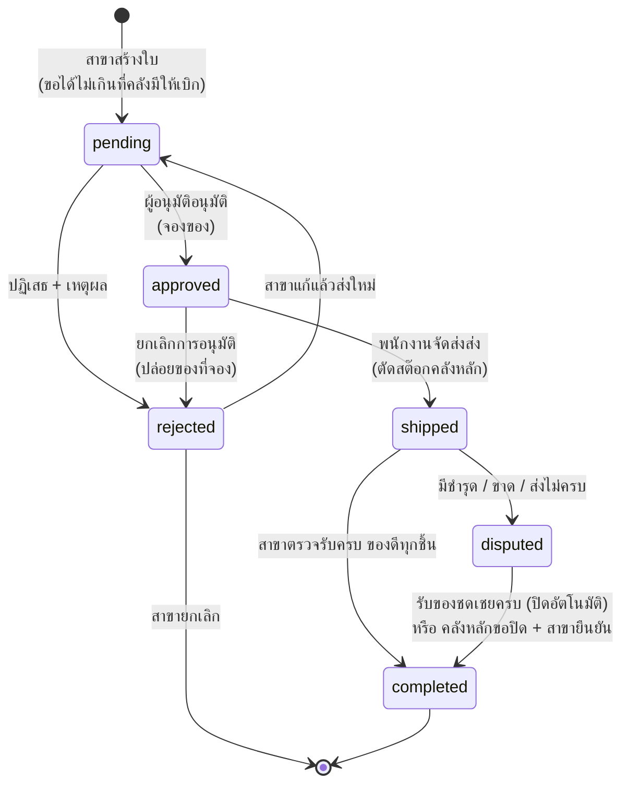

# เอกสารออกแบบระบบ

## 1. สถาปัตยกรรม

```mermaid
flowchart LR
    subgraph ผู้ใช้["ผู้ใช้ทุกสาขา (เบราว์เซอร์ / มือถือ)"]
        A[หน้าเว็บ React]
    end
    subgraph Server["เซิร์ฟเวอร์กลาง (เครื่องเดียว / Railway)"]
        B[Express API<br/>JWT + ตรวจสิทธิ์ตามบทบาท]
        C[(MariaDB / MySQL<br/>ฐานข้อมูลกลางทุกสาขา)]
    end
    A -- "HTTPS / JSON (axios)" --> B
    B -- SQL --> C
    D[สำรองข้อมูลรายวัน<br/>mysqldump] -.-> C
```

- **เซ็นทรัลไลซ์:** ทุกสาขาเขียน/อ่านฐานข้อมูลเดียวกันผ่าน API เดียว — ยอดสต๊อกที่ทุกคนเห็นคือตัวเลขเดียวกันเสมอ
- **Frontend** (`inventory-system/frontend`): React + Tailwind, เก็บ token ใน localStorage, ProtectedRoute กั้นหน้าตามบทบาท
- **Backend** (`inventory-system/backend`): Express แบ่ง routes → controllers, `middleware/authMiddleware` อ่านสิทธิ์ล่าสุดจากฐานข้อมูลทุก request (เปลี่ยนบทบาท/ย้ายสาขามีผลทันที)
- ตอนใช้จริง backend เสิร์ฟหน้าเว็บ (`frontend/dist`) เองได้ → ขึ้นเซิร์ฟเวอร์เป็นบริการเดียว

## 2. บทบาทและสิทธิ์ (RBAC)

| ความสามารถ | admin | ผู้จัดการคลังหลัก (ผู้อนุมัติ) | ผู้จัดการสาขาย่อย | พนักงานสาขา | พนักงานจัดส่ง |
|---|:-:|:-:|:-:|:-:|:-:|
| ดูสต๊อก / สินค้า / รายงาน | ทุกสาขา | ทุกสาขา | สาขาตัวเอง | สาขาตัวเอง | ทุกสาขา |
| เพิ่ม/แก้สินค้า | ✓ | ✓ | ✓ | | |
| รับสินค้าเข้าคลังหลัก | ✓ | ✓ | | | |
| ออกสินค้า (ขาย/ใช้/เสีย) | ✓ | ✓ | ✓ | ✓ (สาขาตัวเอง) | |
| สร้างใบขอเบิก | | | ✓ | ✓ | |
| อนุมัติ / ปฏิเสธ / ยกเลิกอนุมัติ | ✓ | ✓ | | | |
| **จัดส่ง / ส่งของชดเชย** | | | | | ✓ |
| ตรวจรับของ / ยืนยันปิดเคส | | | ✓ (สาขาตัวเอง) | ✓ (สาขาตัวเอง) | |
| ตอบเคสมีปัญหา / ตัดสินใจของชำรุด | ✓ | ✓ | | | |
| ตั้งเกณฑ์แจ้งเตือน | ✓ | ✓ | ✓ (สาขาตัวเอง) | | |
| กำหนดสินค้าประจำสาขา (เปิด/ปิดสินค้าให้แต่ละสาขา) | ✓ | ✓ | | | |
| จัดการผู้ใช้ / สาขา | ✓ | | | | |

**แยกหน้าที่ (Segregation of duties):** คนอนุมัติจัดส่งเองไม่ได้ และคนจัดส่งอนุมัติเองไม่ได้ — ลดโอกาสทุจริต/ผิดพลาด

## 3. ขั้นตอนใบขอเบิก



เคสที่มีปัญหา (`disputed`) มีสถานะย่อย: **รอคลังหลักตอบ** → **กำลังจัดส่งใหม่** / **สต๊อกยังไม่พอ** → **คลังหลักขอปิดเคส**
— ไม่มีฝ่ายไหนปิดเคสเองได้ฝ่ายเดียว, ของชำรุดต้องระบุว่าตัดทิ้งหรือส่งคืนก่อนปิด, ทุกการกระทำบันทึกในไทม์ไลน์ของใบ

## 4. การคำนวณที่สำคัญ

| เรื่อง | วิธีคิด |
|---|---|
| ยอดคงเหลือ | SUM(รับเข้า) − SUM(ออก) จากตาราง `transactions` ต่อ สินค้า × สาขา |
| เบิกได้ (คลังหลัก) | คงเหลือ − ยอดที่อนุมัติให้ใบอื่นแล้วแต่ยังไม่ส่ง |
| เกณฑ์แจ้งเตือน | เกณฑ์เฉพาะสาขา (`alerts`) ถ้าตั้งไว้ ไม่งั้นค่ากลางของสินค้า |
| สถานะสต๊อก | หมด (≤ 0) / ใกล้หมด (< เกณฑ์) / ปกติ |
| ควรสั่งเพิ่ม | เติมให้ถึง max(2 × เกณฑ์, ใช้ 30 วัน, ของที่สาขารออยู่ + เกณฑ์) |
| ยังขาด (ใบขอเบิก) | อนุมัติ − ได้รับสภาพดี − ของชดเชยที่กำลังส่ง |

## 5. ความปลอดภัย
- รหัสผ่านเก็บแบบ bcrypt, ต้องยาว ≥ 8 ตัว, ผู้ใช้เปลี่ยนเองได้, รหัสที่ admin ตั้งให้ต้องเปลี่ยนก่อนใช้งาน (backend บล็อกทุกคำสั่งอื่น)
- token (JWT) ใช้ยืนยันตัวตนเท่านั้น สิทธิ์อ่านจากฐานข้อมูลทุกครั้ง
- ทุก SQL ใช้ parameter (กัน SQL injection), จำนวนทุกช่องตรวจว่าเป็นจำนวนเต็มบวกที่ backend
- `.env` (รหัสฐานข้อมูล/JWT_SECRET) และไฟล์สำรองไม่ขึ้น git
